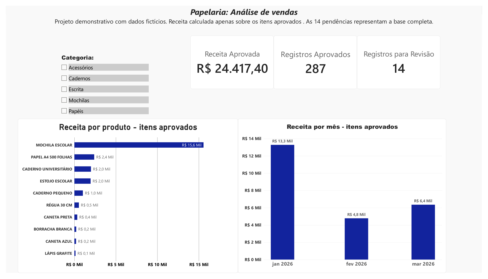
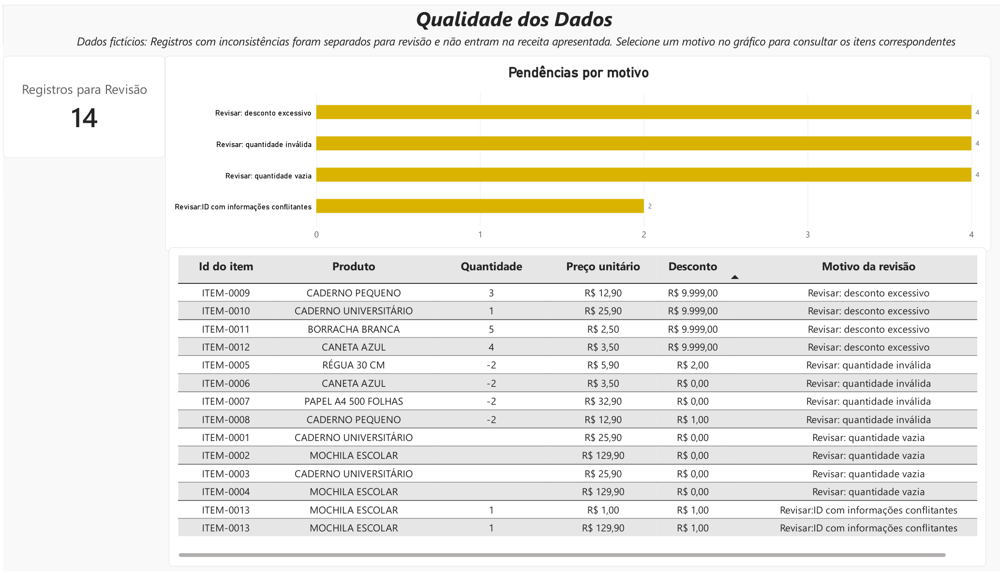

# Papelaria: análise de vendas e qualidade dos dados

Desenvolvi este projeto demonstrativo no Power BI com dados fictícios de uma papelaria entre janeiro e março de 2026.

O painel responde a duas perguntas: quais produtos e meses concentram a receita dos itens aprovados e quais registros precisam de revisão antes de entrar na análise?



## Resultados do tratamento

| Indicador | Resultado |
| --- | ---: |
| Linhas recebidas | 311 |
| Duplicatas idênticas removidas | 10 |
| Registros aprovados | 287 |
| Registros separados para revisão | 14 |
| Receita líquida dos itens aprovados | R$ 24.417,40 |

A conciliação das linhas é: **311 = 10 duplicatas removidas + 287 aprovadas + 14 para revisão**.

As 14 pendências incluem quatro quantidades ausentes, quatro quantidades negativas, quatro descontos superiores ao valor bruto e dois registros com o mesmo ID e informações conflitantes. São 14 linhas e 13 IDs distintos.

## O problema demonstrado

Uma planilha pode apresentar valores que o sistema reconhece como números e, ainda assim, conter inconsistências para o negócio. Quantidades negativas ou descontos maiores que o valor do item, por exemplo, podem distorcer a análise.

Preservei os registros com pendências em uma consulta própria para conferência. Mantive esses registros fora da receita apresentada e não corrigi valores por suposição.

## Páginas do relatório

**Visão de Vendas:** receita dos itens aprovados, quantidade de registros aprovados, total de pendências da base, receita por produto, receita mensal e filtro por categoria.

**Qualidade dos Dados:** total de pendências, distribuição por motivo e tabela com os registros que precisam de conferência. Selecionar um motivo no gráfico filtra o detalhamento.



O indicador de pendências da primeira página representa a base completa e permanece em 14 ao selecionar uma categoria. Os demais indicadores e gráficos representam os itens aprovados no contexto do filtro.

## Ferramentas e processo

- **Power Query:** importação, padronização, tipos de dados, remoção de duplicatas idênticas, identificação de conflitos e separação das consultas.
- **DAX:** medidas de receita e contagens, além de coluna de referência mensal.
- **Power BI:** cartões, gráficos, segmentação por categoria e tabela de conferência.

Construí o tratamento dos dados no Power Query. O script Python incluído em `dados/` apenas gera os dados sintéticos de apoio; ele não executa o tratamento do relatório.

## Etapas de preparação

1. Preservei os dados de entrada na consulta `Vendas_Original`.
2. Criei `Vendas_Tratadas` por referência, removi espaços excedentes e padronizei os nomes dos produtos.
3. Removi duplicatas completamente idênticas, considerando todas as colunas da entrada.
4. Ajustei datas, quantidades, preços e descontos aos tipos adequados, usando a localidade Português (Brasil) nas conversões necessárias.
5. Calculei `valor_bruto` como quantidade × preço unitário.
6. Sinalizei quantidades ausentes ou inválidas e descontos excessivos.
7. Agrupei os registros por `id_item` na consulta `Conferencia_IDs` e identifiquei os IDs que continuavam repetidos após a remoção das cópias idênticas.
8. Mesclei essa conferência em `Vendas_Validadas` e sinalizei os registros com informações conflitantes.
9. Separei os registros nas consultas `Vendas_Aprovadas` e `Vendas_Para_Revisao`. Calculei o valor líquido apenas nos itens aprovados.

Utilizei as consultas intermediárias na preparação dos dados e carreguei as duas consultas finais para alimentar o relatório.

## Cálculos principais

O desconto é um valor em reais por linha de item, não um percentual nem um desconto por unidade.

```text
valor_bruto = quantidade × preco_unitario
valor_liquido = valor_bruto − desconto
```

```dax
Receita Aprovada = SUM(Vendas_Aprovadas[valor_liquido])

Registros Aprovados = COUNTROWS(Vendas_Aprovadas)

Registros para Revisão = COUNTROWS(Vendas_Para_Revisao)
```

Coluna calculada para agrupar os meses:

```dax
Mes = DATE(YEAR(Vendas_Aprovadas[data]), MONTH(Vendas_Aprovadas[data]), 1)
```

## Como abrir

1. Extraia o pacote completo e mantenha os arquivos na mesma organização de pastas.
2. Abra `powerbi/Projeto_Papelaria.pbix` no Power BI Desktop.
3. Para atualizar os dados, acesse **Transformar dados**, selecione `Vendas_Original` e ajuste a etapa **Fonte** para o arquivo `dados/vendas_para_limpeza.csv` extraído no seu computador. O caminho da máquina de origem pode ser diferente.
4. Se necessário, selecione a codificação UTF-8 e o delimitador ponto e vírgula. A primeira linha contém os cabeçalhos.
5. Clique em **Fechar e Aplicar** e confira os totais apresentados acima, sem filtros ativos.

Para consultar o resultado sem abrir o Power BI, use `relatorio/Projeto_Papelaria_Final.pdf`.

## Arquivos de apoio

| Arquivo | Finalidade |
| --- | --- |
| `dados/vendas_para_limpeza.csv` | Entrada usada no projeto, com inconsistências intencionais |
| `dados/vendas_referencia.csv` | Referência sintética antes da introdução das inconsistências |
| `dados/catalogo_produtos.csv` | Catálogo de apoio |
| `dados/gabarito_alteracoes.csv` | Registro das alterações intencionais para conferência |
| `dados/resultado_esperado.json` | Totais esperados do exercício |
| `dados/gerar_base.py` | Gerador dos dados sintéticos |

## Interpretação e limites

O relatório demonstra preparação e análise de dados; não representa uma empresa real nem resultados obtidos para um cliente. A receita apresentada considera somente os 287 itens aprovados. Ela não corresponde à receita completa da base de referência, e não representa lucro, pois o projeto não inclui custos e despesas.

A contagem de registros corresponde a linhas de itens, não a vendas distintas. Uma venda pode ter mais de um item, inclusive itens aprovados e pendentes. As regras de validação cobrem os problemas definidos neste exercício e precisariam ser adaptadas ao contexto de uma empresa real.

Conferi os totais no relatório e com o gabarito sintético. A atualização do PBIX deve ser validada no Power BI Desktop após ajustar o caminho da fonte em outro computador.

## Contato profissional

**Agta Silva Pereira — Análise de dados e automação**

[Portfólio](https://agtapereira.com.br/) · [LinkedIn](https://www.linkedin.com/in/agta-silva-250791193/) · [GitHub](https://github.com/agtavice-cloud)
